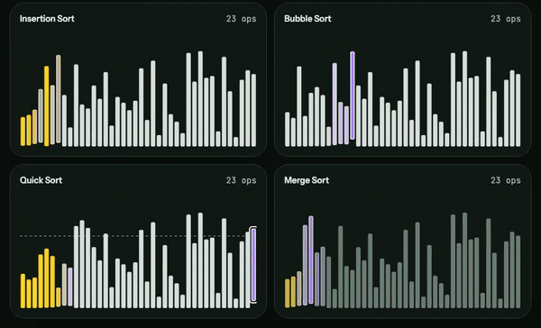
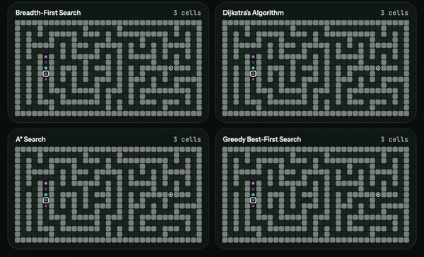
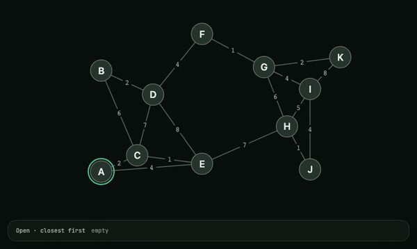
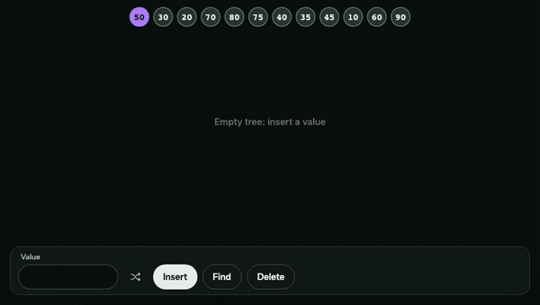
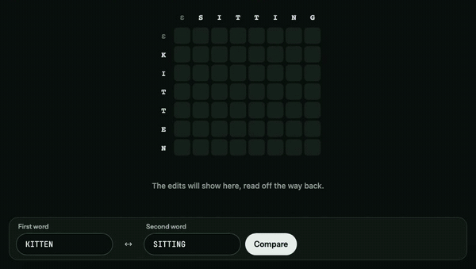
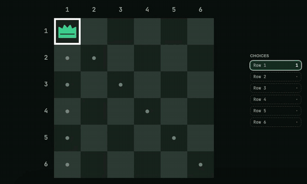
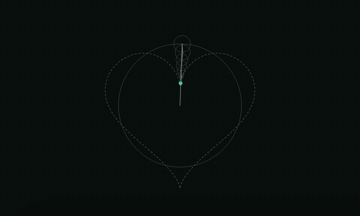

<div align="center">


# Algorithms

**Mira pensar a los algoritmos.**

Un visualizador interactivo donde ves a los algoritmos ejecutarse paso a paso, los haces competir entre sí y pones a prueba lo que entendiste.

Hecho por [Aleph Labs](https://alephlabs.dev) · [Read in English](README.md)

<a href="https://algorithms-aleph.vercel.app/es"></a>

[](https://github.com/alephlabs-dev/algorithms/actions/workflows/ci.yml)
[](LICENSE.txt)

</div>

https://github.com/user-attachments/assets/c06be482-4b34-4bad-bcaa-1cfe82b31e6a

## Módulos

Cada clip es una ejecución real. Haz clic en uno para abrir esa misma ejecución en tu navegador.

<table>
  <tr>
    <td width="50%" valign="top">
      <a href="https://algorithms-aleph.vercel.app/es/sorting/race?size=40&input=random&mode=bars&seed=1t56tk2&race=insertion,bubble,quick,merge&speed=4x"></a>
      <h3>Ordenamiento</h3>
      Selection, Insertion, Bubble, Cocktail Shaker, Shell, Quick, Merge, Heap y Radix Sort, de 10 a 400 elementos.
    </td>
    <td width="50%" valign="top">
      <a href="https://algorithms-aleph.vercel.app/es/pathfinding/race?grid=medium&cells=VVVVVVVVVVUFBAAEQAAABBQRVVERVVURUQQEBEAABAREURVRURURURVFAERAQAREQBQREVURURURUUAEQEAEQEBAEREVURFRFRVFREQERERAABQREREVURFRVUQEBAREQEBAEVFRFRVRVRVFBARABEQAQBRRUVURERUVUQAEAEAEAARAVVVVVVVVVVUB&from=7h&to=83&race=bfs,dijkstra,astar,greedy&speed=4x"></a>
      <h3>Búsqueda de caminos</h3>
      BFS, DFS, Dijkstra, A* y Greedy Best-First sobre una cuadrícula que puedes pintar: paredes, barro, laberintos.
    </td>
  </tr>
  <tr>
    <td width="50%" valign="top">
      <a href="https://algorithms-aleph.vercel.app/es/graphs/dijkstra?graph=ArQLAAA12DVJTsFZa3vNexWmRLaYxmPG1ds2EQACAgoICAgHBQYIBAkHAQEDAgQCAQMCBwYFAQMFBAYHBgoGAgkIBAQDCAQHBwQABAECBg&nodes=medium&layout=random&speed=2x"></a>
      <h3>Grafos</h3>
      BFS, DFS, Dijkstra, Prim, Kruskal y orden topológico sobre grafos que puedes arrastrar y reconectar.
    </td>
    <td width="50%" valign="top">
      <a href="https://algorithms-aleph.vercel.app/es/structures/avl-tree?ops=i50.i30.i20.i70.i80.i75.i40.i35.i45.i10.i60.i90&values=medium&order=example&speed=4x"></a>
      <h3>Estructuras de datos</h3>
      Árbol binario de búsqueda, árbol AVL, min-heap y tablas hash con encadenamiento o sondeo lineal.
    </td>
  </tr>
  <tr>
    <td width="50%" valign="top">
      <a href="https://algorithms-aleph.vercel.app/es/dynamic-programming/edit-distance?a=KITTEN&b=SITTING&speed=4x"></a>
      <h3>Programación dinámica</h3>
      Distancia de edición, subsecuencia común más larga y mochila 0/1, con tabla, memoización o recursión simple.
    </td>
    <td width="50%" valign="top">
      <a href="https://algorithms-aleph.vercel.app/es/backtracking/n-queens?speed=4x"></a>
      <h3>Backtracking</h3>
      N reinas y Sudoku: mira cómo el algoritmo prueba, llega a un callejón sin salida y retrocede.
    </td>
  </tr>
  <tr>
    <td width="50%" valign="top">
      <a href="https://algorithms-aleph.vercel.app/es/fourier/epicycles?circles=50&shape=heart&speed=2x"></a>
      <h3>Fourier</h3>
      Ondas cuadrada, de sierra y triangular, y epiciclos que redibujan cualquier forma, incluso una que dibujes tú.
    </td>
    <td width="50%" valign="top">
      <h3>Laberintos</h3>
      <em>Próximamente:</em> generación de laberintos paso a paso (DFS, Prim, Kruskal, Wilson). Síguelo en <a href="https://github.com/alephlabs-dev/algorithms/issues/150">#150</a>.
    </td>
  </tr>
</table>

## En todos los módulos

- **Paso a paso.** Reproduce, pausa, avanza y retrocede, o arrastra a cualquier punto de la ejecución.
- **El código, resaltado.** Pseudocódigo con la línea en curso resaltada y cada paso explicado en palabras simples.
- **Carreras.** De dos a cuatro algoritmos con la misma entrada y el mismo reloj, para ver cuál hace de verdad menos trabajo.
- **Modo adivinanza.** La reproducción se detiene antes de un momento clave y pregunta qué pasa después, con puntaje y racha (ordenamiento, búsqueda de caminos y N reinas).
- **Comparte cualquier ejecución.** El enlace lleva el arreglo, la cuadrícula o el grafo exactos, así otros ven lo mismo que tú.
- **Español e inglés**, en teléfonos, tablets y escritorio, con atajos de teclado, texto para lectores de pantalla en cada paso y soporte para movimiento reducido.

## Cómo se construye

Este proyecto se construye con agentes de IA ([Claude Code](https://claude.com/claude-code)) que escriben la mayor parte del código, y una persona que decide qué construir. Lo que hace que funcione:

- **[`CLAUDE.md`](CLAUDE.md)**: las reglas que sigue todo agente: una rama por issue, nunca debilitar un test, correr los tests en el navegador antes de terminar.
- **[`GLOSSARY.md`](GLOSSARY.md)** and **[`docs/adr/`](docs/adr)**: un lenguaje compartido (*run*, *racer*, *key moment*) y las decisiones detrás del diseño.
- **Issues como especificaciones**: el trabajo se escribe como issues etiquetados [`ready-for-agent`](https://github.com/alephlabs-dev/algorithms/issues?q=is%3Aopen+label%3Aready-for-agent) o `ready-for-human`.
- **Tests en cuatro pantallas**: Playwright y axe en iPhone, iPad (vertical y horizontal) y escritorio, más un chequeo de que cada frase de paso entra en su leyenda.
- **Módulos enchufables**: un módulo es un slice de estado más una interfaz; [`src/modules/README.md`](src/modules/README.md) explica cómo sumar uno.

## Correrlo localmente

```bash
git clone https://github.com/alephlabs-dev/algorithms.git && cd algorithms
pnpm install
pnpm dev   # http://localhost:5173
```

Necesita Node 24+ y pnpm. Tests, arquitectura y cómo contribuir (en inglés): [CONTRIBUTING.md](CONTRIBUTING.md).

## Licencia

[MIT](LICENSE.txt)
