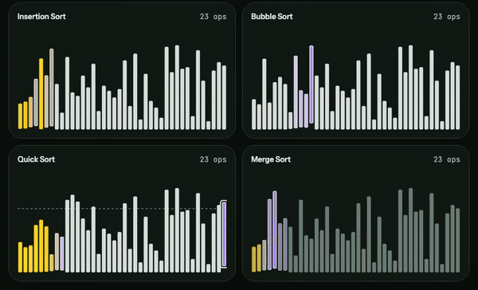
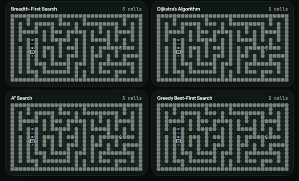
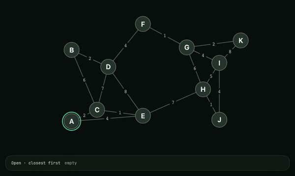
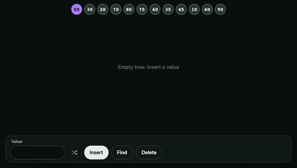
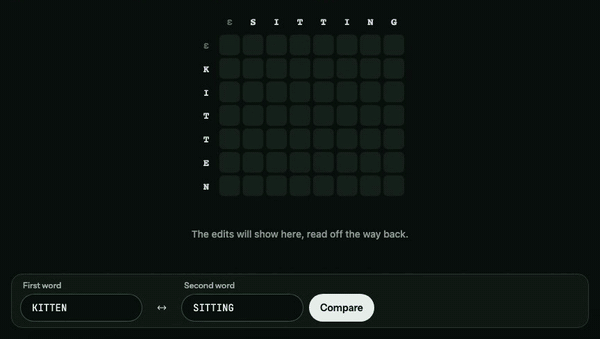
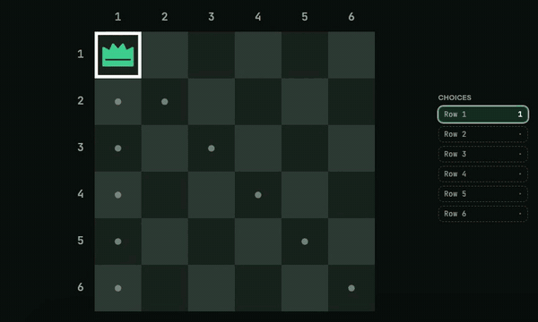
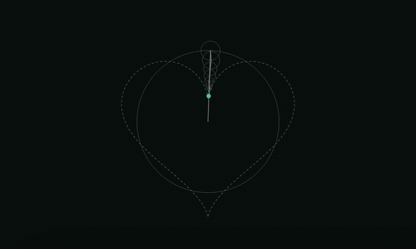

<div align="center">


# Algorithms

**Watch algorithms think.**

An interactive visualizer where you watch algorithms run step by step, race them against each other, and test what you've understood.

Built by [Aleph Labs](https://alephlabs.dev) · [Leer en español](README.es.md)

<a href="https://algorithms-aleph.vercel.app"></a>

[](https://github.com/alephlabs-dev/algorithms/actions/workflows/ci.yml)
[](LICENSE.txt)

</div>

https://github.com/user-attachments/assets/c06be482-4b34-4bad-bcaa-1cfe82b31e6a

## Modules

Every clip is a real run. Click one to open that exact run in your browser.

<table>
  <tr>
    <td width="50%" valign="top">
      <a href="https://algorithms-aleph.vercel.app/sorting/race?size=40&input=random&mode=bars&seed=1t56tk2&race=insertion,bubble,quick,merge&speed=4x"></a>
      <h3>Sorting</h3>
      Selection, Insertion, Bubble, Cocktail Shaker, Shell, Quick, Merge, Heap and Radix Sort, from 10 to 400 items.
    </td>
    <td width="50%" valign="top">
      <a href="https://algorithms-aleph.vercel.app/pathfinding/race?grid=medium&cells=VVVVVVVVVVUFBAAEQAAABBQRVVERVVURUQQEBEAABAREURVRURURURVFAERAQAREQBQREVURURURUUAEQEAEQEBAEREVURFRFRVFREQERERAABQREREVURFRVUQEBAREQEBAEVFRFRVRVRVFBARABEQAQBRRUVURERUVUQAEAEAEAARAVVVVVVVVVVUB&from=7h&to=83&race=bfs,dijkstra,astar,greedy&speed=4x"></a>
      <h3>Pathfinding</h3>
      BFS, DFS, Dijkstra, A* and Greedy Best-First on a grid you can paint: walls, mud, mazes.
    </td>
  </tr>
  <tr>
    <td width="50%" valign="top">
      <a href="https://algorithms-aleph.vercel.app/graphs/dijkstra?graph=ArQLAAA12DVJTsFZa3vNexWmRLaYxmPG1ds2EQACAgoICAgHBQYIBAkHAQEDAgQCAQMCBwYFAQMFBAYHBgoGAgkIBAQDCAQHBwQABAECBg&nodes=medium&layout=random&speed=2x"></a>
      <h3>Graphs</h3>
      BFS, DFS, Dijkstra, Prim, Kruskal and topological sort on graphs you can drag and rewire.
    </td>
    <td width="50%" valign="top">
      <a href="https://algorithms-aleph.vercel.app/structures/avl-tree?ops=i50.i30.i20.i70.i80.i75.i40.i35.i45.i10.i60.i90&values=medium&order=example&speed=4x"></a>
      <h3>Data structures</h3>
      Binary search tree, AVL tree, min-heap, and hash tables with chaining or linear probing.
    </td>
  </tr>
  <tr>
    <td width="50%" valign="top">
      <a href="https://algorithms-aleph.vercel.app/dynamic-programming/edit-distance?a=KITTEN&b=SITTING&speed=4x"></a>
      <h3>Dynamic programming</h3>
      Edit distance, longest common subsequence and 0/1 knapsack, as a table, memoized or plain recursion.
    </td>
    <td width="50%" valign="top">
      <a href="https://algorithms-aleph.vercel.app/backtracking/n-queens?speed=4x"></a>
      <h3>Backtracking</h3>
      N-Queens and Sudoku: watch the solver try, hit a dead end, and step back.
    </td>
  </tr>
  <tr>
    <td width="50%" valign="top">
      <a href="https://algorithms-aleph.vercel.app/fourier/epicycles?circles=50&shape=heart&speed=2x"></a>
      <h3>Fourier</h3>
      Square, sawtooth and triangle waves, and epicycles that redraw any shape, even one you draw.
    </td>
    <td width="50%" valign="top">
      <h3>Mazes</h3>
      <em>Coming soon:</em> maze generation step by step (DFS, Prim, Kruskal, Wilson). Follow <a href="https://github.com/alephlabs-dev/algorithms/issues/150">#150</a>.
    </td>
  </tr>
</table>

## In every module

- **One step at a time.** Play, pause, step back and forth, or drag to any point of the run.
- **The code, lit up.** Pseudocode with the running line highlighted, and each step in plain words.
- **Races.** Two to four algorithms on the same input and the same clock, to see which one really does less work.
- **Guess mode.** Playback stops before a key moment and asks what happens next, keeping score and streak (sorting, pathfinding and N-Queens).
- **Share any run.** The link carries the exact array, grid or graph, so others see what you see.
- **English and Spanish**, on phones, tablets and desktop, with keyboard shortcuts, screen reader text for every step, and support for reduced motion.

## How it's built

This project is built with AI agents ([Claude Code](https://claude.com/claude-code)) doing most of the coding and a human deciding what to build. What keeps that working:

- **[`CLAUDE.md`](CLAUDE.md)**: the rules every agent follows: one branch per issue, never weaken a test, run the browser tests before finishing.
- **[`GLOSSARY.md`](GLOSSARY.md)** and **[`docs/adr/`](docs/adr)**: one shared language (a *run*, a *racer*, a *key moment*) and the decisions behind the design.
- **Issues as specs**: work is written up as issues and labeled [`ready-for-agent`](https://github.com/alephlabs-dev/algorithms/issues?q=is%3Aopen+label%3Aready-for-agent) or `ready-for-human`.
- **Tests on four screens**: Playwright and axe on iPhone, iPad (portrait and landscape) and desktop, plus a check that every step sentence fits its caption.
- **Modules as plug-ins**: a module is a state slice plus an interface; [`src/modules/README.md`](src/modules/README.md) shows how to add one.

## Run locally

```bash
git clone https://github.com/alephlabs-dev/algorithms.git && cd algorithms
pnpm install
pnpm dev   # http://localhost:5173
```

Needs Node 24+ and pnpm. Tests, architecture and how to contribute: [CONTRIBUTING.md](CONTRIBUTING.md).

## License

[MIT](LICENSE.txt)
